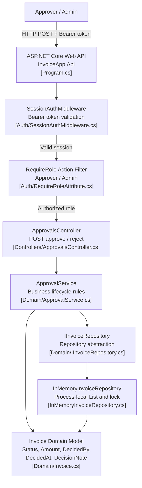
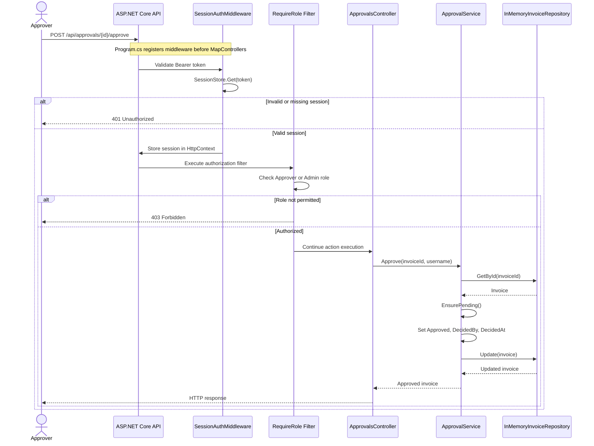

# Invoice Approval Service – Architecture Analysis

## 1. As-built container architecture

The following diagram represents the implementation currently present in the repository, not the proposed production architecture.

## 2. Approval sequence diagram

## 3. Inference and evidence register

| Diagram element / finding | Evidence |
|---|---|
| ASP.NET Core API and dependency registration | `backend/src/InvoiceApp.Api/Program.cs` |
| Authentication middleware validates bearer token | `backend/src/InvoiceApp.Api/Auth/SessionAuthMiddleware.cs` |
| Role authorization checks Approver/Admin | `backend/src/InvoiceApp.Api/Auth/RequireRoleAttribute.cs` |
| Approval and rejection endpoints | `backend/src/InvoiceApp.Api/Controllers/ApprovalsController.cs` |
| Approval business rules and lifecycle | `backend/src/InvoiceApp.Domain/ApprovalService.cs` |
| Repository abstraction | `backend/src/InvoiceApp.Domain/IInvoiceRepository.cs` |
| Process-local in-memory storage | `backend/src/InvoiceApp.Api/InMemoryInvoiceRepository.cs` |
| Invoice decision fields | `backend/src/InvoiceApp.Domain/Invoice.cs` |

### Explicit inferences

1. The application is not currently durable because invoices are held in process memory.
2. Multiple application instances would not automatically share invoice state.
3. The current approval update does not demonstrate an atomic database transaction.
4. The current implementation does not demonstrate a durable audit retention mechanism.
5. There is no implemented PayEx integration or message-based payment workflow.
6. Azure SQL and Azure Service Bus are target-state components described in the assignment scenario, not current application components.

## 4. Target architecture status

The target architecture will be documented separately. Azure SQL, transactional outbox, Service Bus, payment worker, PayEx integration, and reconciliation must be marked as proposed components until implemented and deployed.

