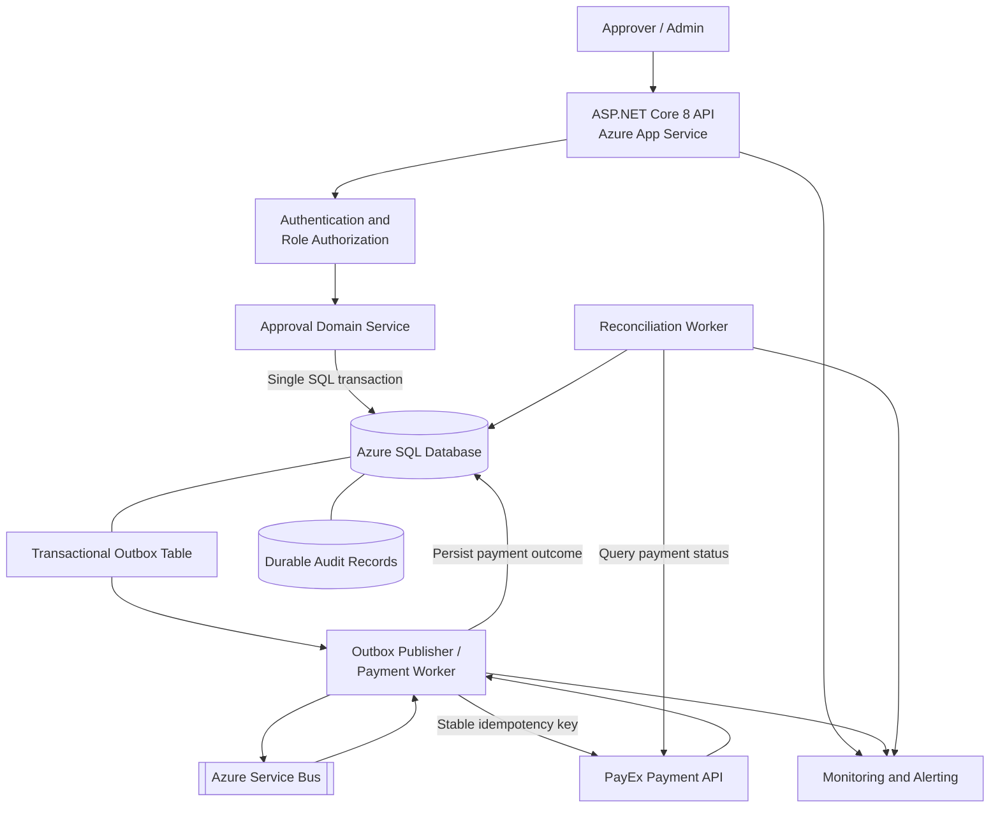
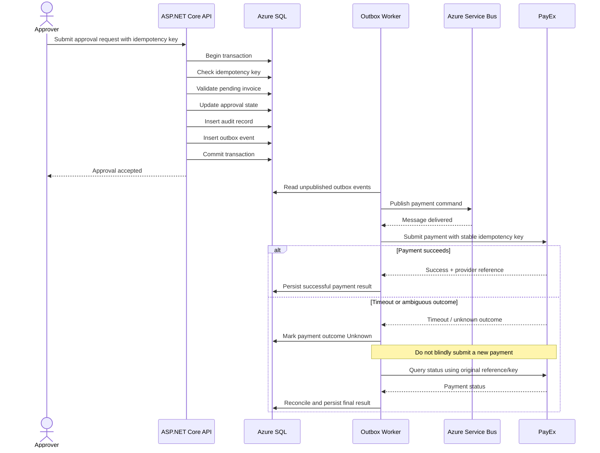

# Target Architecture – Invoice Approval Service

## 1. Proposed production architecture

The proposed design introduces durable invoice storage, asynchronous payment processing, duplicate protection and reconciliation.

**Important:** All components below are proposed. They are not currently implemented in the repository.

## 2. Approval and payment sequence

## 3. Proposed components and responsibilities

| Component | Responsibility | Status |
|---|---|---|
| ASP.NET Core API | Accept invoice approval requests | Existing, target hosting proposed |
| Azure App Service | Host API instances | Proposed |
| Azure SQL | Durable invoice and payment state | Proposed |
| Idempotency records | Prevent duplicate approval submissions | Proposed |
| Transactional outbox | Atomically persist business change and event | Proposed |
| Azure Service Bus | Deliver asynchronous payment commands | Provisioned in scenario; not integrated |
| Payment worker | Process payment commands safely | Proposed |
| PayEx | External payment provider | Scenario only; not integrated |
| Audit records | Retain approval and payment history for seven years | Proposed |
| Reconciliation worker | Resolve unknown payment outcomes | Proposed |
| Monitoring | Track failures, queue age and payment status | Proposed |

## 4. Reliability and security controls

1. Store approval state, audit record and outbox event in one Azure SQL transaction.
2. Use a unique idempotency key with a database uniqueness constraint.
3. Reuse the same provider idempotency key when checking or retrying an ambiguous PayEx request.
4. Treat Service Bus delivery as at-least-once and make consumers idempotent.
5. Never interpret an HTTP timeout as proof that PayEx did not process a payment.
6. Maintain an Unknown or PendingReconciliation state for ambiguous outcomes.
7. Reconcile unknown payment outcomes with PayEx before attempting another payment.
8. Restrict access to payment and audit data using least privilege.
9. Encrypt data in transit and at rest.
10. Apply an approved retention and archival policy for seven-year audit records.

## 5. Important design qualification

The transactional outbox guarantees that the database state change and event creation are committed together. It does not, by itself, guarantee exactly-once external payment execution.

Exactly-once business outcomes require provider-side idempotency or authoritative payment-status lookup, together with local deduplication and reconciliation.

